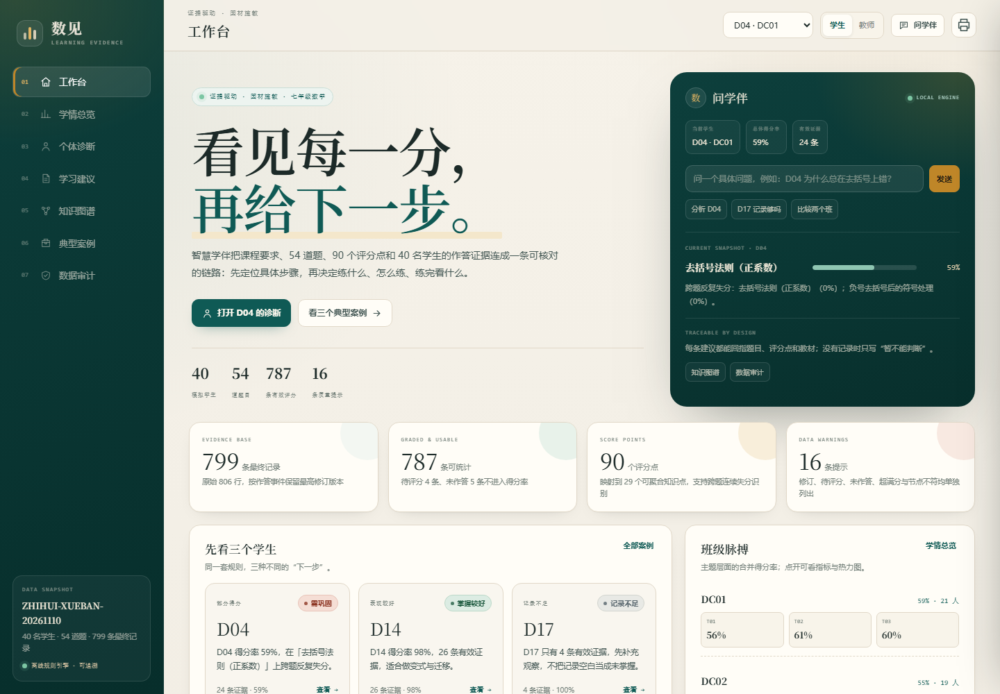

# 数见 · 智慧学伴

> 七年级数学学情诊断与个性化学习智能体
> 三个主题 · 9 个观察指标 · 54 道题 · 90 个评分点 · 40 名模拟学生



## 在线演示

**GitHub Pages**：<https://YOUR_GITHUB_USERNAME.github.io/shujian-learning-companion/>

> 演示页是单文件 HTML，已内嵌赛事模拟学情数据；原始 CSV / PDF / 教材切片**未包含在仓库中**，仅保留代码与演示。赛题资料的使用范围以赛题组要求为准。

## 一句话

把「课程要求 → 观察指标 → 题目 → 评分点 → 学生作答」连成一条可核对、可追溯、可调整的学习证据链：先定位具体步骤，再决定下一步练什么。

## 三项任务的落点

| 赛题任务 | 对应实现 |
|----------|----------|
| 任务 1：学习内容与要求 | `src/knowledge_graph.py` + 网页「知识图谱」 |
| 任务 2：学生学习情况分析 | `src/diagnostics.py` + 网页「学情总览 / 个体诊断 / 数据审计」 |
| 任务 3：个性化学习建议 | `src/recommendation.py` + 网页「学习建议」 |
| 结果核对 / 典型案例 | `src/agent.py` + 网页「典型案例」 |

## 六个差异化点

1. **评分点级精细诊断**：按知识点聚合 90 个评分点，识别“跨题系统性薄弱”与“同题多步失分”。
2. **修订版本追踪**：同一作答事件保留最高修订版本，并分析改对、改错、改了几次。
3. **节点间纵向分析**：只比较 N01/N02 都有证据的指标，不把单节点记录强行解释成进步/退步。
4. **交叉关联诊断**：用指标前置依赖解释“为什么这个指标可能补不动”，并注明需要更多过程证据，不把相关当因果。
5. **记录不足的诚实处理**：证据 ≤1 道题的指标只生成“补充观察”，不写成“补弱”。
6. **建议可执行且不直接给答案**：每条建议有题目编号、评分点证据、教材位置、分步提示、完成条件和后续调整。

## 网页功能

- **工作台**：学伴对话、当前学生快照、三个典型案例。
- **学情总览**：班级对照、共性问题、分化指标、学生 × 指标热力图。
- **个体诊断**：主题 / 指标 / 评分点四级下钻、修订轨迹、N01→N02 纵向对比、交叉关联、记录空白。
- **学习建议**：分阶段任务、启发式提示、教材定位、补充观察；支持“太难 / 太简单 / 时间不够 / 先补基础 / 换一道”反馈调整。
- **知识图谱**：主题 → 指标 → 题目的前置依赖图，题库与知识点索引。
- **典型案例**：D04 部分得分、D14 表现较好、D17 记录不足，完整展示“要求—表现—诊断—建议—核对”。
- **数据审计**：修订、待评分、未作答、超满分、节点不符与原始记录检索。

## 仓库结构

```
.
├── dist/
│   ├── index.html                    # 单文件演示（可直接打开）
│   └── 数见-智慧学伴-单文件.zip       # 单文件压缩包
├── docs/
│   ├── index.html                    # GitHub Pages 入口
│   ├── preview.png                   # 预览图
│   └── .nojekyll
├── src/
│   ├── data_loader.py                # 数据加载、清洗、质量校验
│   ├── knowledge_graph.py            # 主题/指标/题目/评分点/知识点图谱
│   ├── diagnostics.py                # 个体 + 群体 + 评分点级诊断
│   ├── recommendation.py             # 规则驱动学习建议
│   ├── llm_client.py                 # 文心一言客户端（可选）
│   ├── llm_formatter.py              # LLM 包装 + 离线自然语言层
│   └── agent.py                      # 智能体编排
├── web/                              # 模板 / CSS / JS 源码
├── data/README.md                    # 数据放置说明（原始数据未包含）
├── output/field_descriptions.md      # 输出字段说明
├── config.py
├── run.py
├── build_web.py
└── requirements.txt
```

## 本地打开

最简单：直接双击 **`docs/index.html`** 或 **`dist/index.html`**。
单文件已内嵌数据，无需安装 Python、无需联网。

## 从源码运行

赛题原始 CSV / PDF 未包含在仓库中。按 `data/README.md` 把数据放入 `data/` 后：

```bash
pip install -r requirements.txt
python run.py
```

`run.py` 会完成：

1. 数据加载、清洗、校验
2. 知识图谱构建
3. 40 名学生个体诊断
4. DC01 / DC02 / ALL 群体诊断与两班对比
5. 40 份个性化学习建议
6. 典型案例与字段说明
7. 单文件网页构建

可选：配置文心一言后润色自然语言。

```powershell
$env:WENXIN_API_KEY = "..."
$env:WENXIN_SECRET_KEY = "..."
python run.py --llm
```

没有 API Key 时使用离线规则引擎 + 模板 NLG，不影响完整功能。

## 数据口径

- 原始 806 行 → 799 个唯一作答事件（同一事件保留最高修订版本）。
- 已评分 790 条，待评分 4 条，未作答 5 条。
- 可统计 787 条（已评分且通过引用/分值/节点校验）。
- 隔离 3 条：2 条超满分、1 条节点题目不符。
- 评分点明细与总分不一致时：总分参与指标统计，明细不参与知识点聚合。
- 未作答不算答错；待评分不进入得分率；无记录不等于未掌握。

## 使用声明

- 学生与作答记录均为赛事模拟数据，不对应真实学生。
- 赛题原始资料仅限本次大赛使用；本仓库不包含原始 CSV / PDF。
- 演示页内嵌模拟数据，仅用于作品展示与结果核对。
